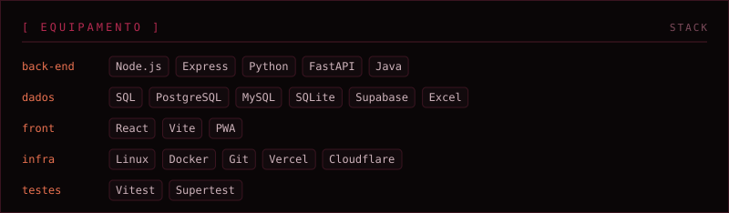
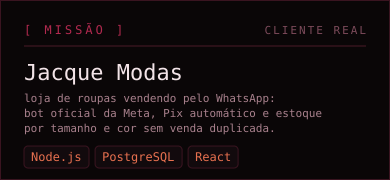
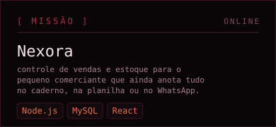
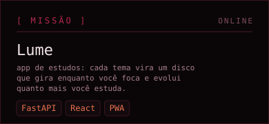
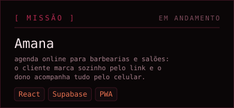

  

### `> sobre`

Formando em **Análise e Desenvolvimento de Sistemas** (dez/2026), em Belém, PA.
Faço sistemas de ponta a ponta para pequenos negócios, com foco no **back-end**: APIs, banco de dados, integrações (WhatsApp, Pix) e testes.
Em casa, mantenho um servidor Linux com Docker, onde testo tudo o que dá.

🔎 **Procurando a primeira vaga como dev júnior**, em Belém ou remoto.

  

### `> missões`

<table>
  <tr>
    <td width="50%"> repositório privado (cliente real)</td>
    <td width="50%"> <a href="https://nexora-app-eosin.vercel.app">ver online →</a></td>
  </tr>
  <tr>
    <td width="50%"> <a href="https://estudo-gamificado-two.vercel.app">ver online →</a></td>
    <td width="50%"></td>
  </tr>
</table>

  

  <a href="https://martinskb.github.io">[ entrar na save room → martinskb.github.io ]</a> 
  contato: <a href="mailto:martinskb.contato@gmail.com">martinskb.contato@gmail.com</a>

